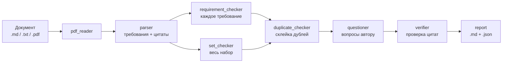

# ReqGuard — AI-агент проверки качества требований

ReqGuard читает готовое техническое задание (ТЗ) и находит в нём дефекты:
неоднозначные формулировки, непроверяемые требования, недостающие сценарии,
противоречия между разделами. По каждому дефекту агент даёт дословную цитату
с номером строки и уточняющий вопрос автору документа. Отчёт пишется на русском.

Проект сделан для кейса BCC-HUB x MNU Agent Challenge 2026.

```text
python main.py docs/requirements.md reports/report.md
```

На выходе — `report.md` (читаемый отчёт) и `report.json` (те же данные для автоматической проверки).

---

## Что умеет

- **Разбирает документ на требования.** Функциональные и нефункциональные требования, цели,
  бизнес-правила, строки таблиц параметров API, HTTP-статусы, критерии приёмки.
  Поддерживаются `.md`, `.txt` и `.pdf`.
- **Проверяет каждое требование** по критериям ISO/IEC/IEEE 29148:2018 (п. 5.2.5–5.2.6)
  и IEEE 830-1998 (п. 4.3):

  | Тип дефекта | Пример |
  |---|---|
  | `ambiguity` — неоднозначность | «текущая задолженность» — включает ли проценты? |
  | `unverifiable` — непроверяемость | «сократить количество обращений» без числа и срока |
  | `incomplete` — неполнота | «минимально допустимая сумма» нигде не задана |
  | `design_decision` — необоснованное решение | технология навязана без причины |

- **Проверяет весь набор целиком** — то, что видно только при сравнении разных частей документа:

  | Тип дефекта | Пример |
  |---|---|
  | `contradiction` — противоречие | «без сервиса графиков операцию не проводить» против статуса 202 «операция принята, пересчёт отложен» |
  | `gap` — пропуск | в схеме процесса есть «недостаточно средств», а в API нет такого ответа |
  | `duplicate` — дубль | одно обязательство записано дважды |

- **Не выдумывает.** Каждая цитата проверяется кодом по тексту документа.
  Дефект без найденной цитаты в отчёт не попадает.
- **Формулирует вопросы автору** — конкретные, по одному на дефект.
- **Даёт итог:** можно ли начинать разработку по документу или сначала нужно его исправить.

---

## Быстрый старт

### 1. Установка

Нужен Python 3.10+.

```bash
git clone https://github.com/glore81/req-guard.git
cd req-guard
python -m venv .venv
source .venv/bin/activate          # Windows: .venv\Scripts\activate
pip install -r requirements.txt
```

### 2. Ключи API (бесплатные)

Скопируйте `.env.example` в `.env` и впишите хотя бы один ключ:

| Провайдер | Где взять | Переменная |
|---|---|---|
| Google Gemini | https://aistudio.google.com/apikey | `GEMINI_API_KEY` |
| Groq | https://console.groq.com/keys | `GROQ_API_KEY` |

- **Оба ключа** — рекомендуемый режим: требования проверяет Gemini, противоречия ищет
  рассуждающая модель на Groq, при сбое одного провайдера запросы подхватывает другой.
- **Только один ключ** — всё работает на этом провайдере, второй просто пропускается.

> Файл `.env` в репозиторий не коммитится (он в `.gitignore`).

### 3. Запуск

```bash
python main.py <документ> <отчёт.md> [флаги]
```

```bash
python main.py docs/requirements.md reports/report.md      # основной пример
python main.py docs/test1.md reports/test1_report.md       # независимый проверочный документ
```

| Флаг | Что делает |
|---|---|
| `--no-cache` | не использовать и не сохранять кэш ответов модели (для финального прогона) |
| `--clear-cache` | удалить кэш `.llm_cache/` перед запуском |
| `--dry-run` | без модели, на простых правилах — проверить, что всё установлено |

Один документ на 200–300 строк — это примерно **12–18 запросов к модели** и несколько минут работы.

---

## Как устроен агент



| Модуль | Модель | Что делает |
|---|---|---|
| `src/pdf_reader.py` | — | читает документ, сохраняет номера строк (MD/TXT) или страниц (PDF) |
| `src/agents/parser.py` | Gemini | выделяет требования с дословной цитатой; таблицы критериев приёмки разбирает кодом; повторно разбирает разделы, где модель пропустила строки; схемы в блоках кода требованиями не считает |
| `src/agents/requirement_checker.py` | Gemini | проверяет требования пачками по 10 — в ~10 раз меньше запросов |
| `src/agents/set_checker.py` | Groq gpt-oss-120b | ищет противоречия и пропуски по всему документу в два прохода: бизнес-правила и согласованность API |
| `src/agents/duplicate_checker.py` | — (код) | склеивает одну и ту же проблему, найденную разными агентами |
| `src/agents/questioner.py` | Gemini | формулирует уточняющие вопросы |
| `src/verifier.py` | — (код) | отбрасывает дефекты без реальной цитаты и проставляет номер строки |
| `src/report.py` | — | собирает отчёт |
| `src/llm.py` | — | единая обёртка над Gemini и Groq: цепочка запасных моделей, лимиты, кэш |

Подробнее об агентах — в [`docs/agents.md`](docs/agents.md).

### Защита от галлюцинаций

1. Модель обязана привести **дословную цитату**; поиск допускает только другие разделители
   (пробелы, `|` таблиц), `ё/е` и окончание слова, но в отчёт всегда попадает точный текст документа.
2. Номер строки вычисляет **код**, а не модель.
3. Дефект с несуществующим ID требования или цитатой, которой нет в документе, отбрасывается.
4. Парсер и проверка набора работают с `temperature=0` — результат стабильнее от прогона к прогону.

### Устойчивость к лимитам бесплатных API

Модели перебираются по цепочке (по умолчанию `gemini-3.5-flash-lite` → `gemini-2.5-flash-lite` →
`gemini-3.6-flash` → `groq:openai/gpt-oss-120b`):

| Ситуация | Что делает агент |
|---|---|
| лимит в минуту (429) | ждёт столько, сколько просит провайдер, и повторяет ту же модель |
| дневной лимит (429 per day) | исключает модель до конца прогона |
| сервер перегружен (503) | временно переходит к следующей модели |
| модель недоступна ключу (404) | исключает модель до конца прогона |
| запрос не помещается в лимит Groq (413) | отдаёт запрос другой модели; для проверки набора — `gemini-3.6-flash` |

Все ответы кэшируются в `.llm_cache/`: если прогон прервался, после перезапуска уже полученные
ответы берутся с диска.

Модели можно переопределить в `.env`: `LLM_MODEL`, `LLM_FALLBACKS`, `SET_CHECKER_MODEL`,
`SET_CHECKER_FALLBACK` (примеры — в `.env.example`).

---

## Качество

Качество измеряем по документам с эталонной разметкой дефектов:

- **Recall (полнота)** — какую долю эталонных дефектов агент нашёл;
- **Precision (точность)** — какая доля замечаний агента — реальные дефекты, а не придирки.

| Документ | Эталон | Recall | Precision |
|---|---|---|---|
| `docs/requirements.md` — документ кейса | ручная разметка команды (15 дефектов) | 40–47% | ~30% |
| `docs/test1.md` — **независимый** ТЗ (досрочное погашение кредита), сгенерирован DeepSeek | разметка DeepSeek, `evaluation/gold_test1_deepseek.json` | 44% строго, 67% с близкими находками | ~53% |
| `docs/test1.md` | разметка команды, `evaluation/gold_test1_own.json` | 29–36% строго, 43% с близкими | — |

Как считали:
- сопоставление «один найденный дефект — один эталонный», вручную, по месту и сути проблемы;
- диапазон — разброс между прогонами (часть прогонов шла на запасных моделях из-за перегрузки Gemini);
- precision по `test1.md` учитывает и реальные дефекты, которых нет в эталоне
  (например, `chargedAmount` «больше 0» в таблице, но `0.00` во всех примерах ошибок).

**Почему отдельный документ.** Промпты настраивались на `docs/requirements.md`. Чтобы проверить,
что агент не подогнан под него, `docs/test1.md` используется только для замера: под него промпты
не менялись, а эталон размечен независимой моделью без доступа к агенту.

Инструмент ручной оценки отчёта по эталону:

```bash
python evaluation/evaluate.py evaluation/ground_truth.json reports/ai_report.json
```

---

## Тесты

```bash
python -m pytest -q
```

95 тестов, без сети и ключей: модели подменяются заглушками. Покрыты парсер (цитаты, таблицы,
служебные разделы, повторный разбор), обе проверки, склейка дублей, верификатор и обёртка LLM
(цепочка моделей, лимиты, 413/404).

---

## Структура проекта

```text
req-guard/
├── main.py                  # точка входа (CLI)
├── src/
│   ├── pdf_reader.py        # чтение PDF / MD / TXT
│   ├── pipeline.py          # порядок агентов
│   ├── llm.py               # Gemini + Groq: цепочка моделей, лимиты, кэш
│   ├── schema.py            # общие структуры данных
│   ├── verifier.py          # проверка цитат
│   ├── report.py            # Markdown + JSON отчёт
│   └── agents/
│       ├── parser.py
│       ├── requirement_checker.py
│       ├── set_checker.py
│       ├── duplicate_checker.py
│       └── questioner.py
├── docs/
│   ├── requirements.md      # документ кейса
│   ├── test1.md             # независимый проверочный документ
│   └── agents.md            # описание агентов
├── evaluation/              # эталоны и оценка
├── reports/                 # примеры отчётов
├── tests/
├── requirements.txt
└── .env.example
```

---

## Ограничения

- **Recall около половины.** Агент лучше всего находит неоднозначные и непроверяемые формулировки;
  многошаговые противоречия между разделами находит реже. Отчёт — помощник аналитику, а не замена ревью.
- **Есть придирки.** Часть замечаний — мелкие вопросы к UI («какой текст сообщения об ошибке»).
- **Бесплатные лимиты.** Gemini даёт около 20 запросов в день на модель и иногда перегружен (503);
  у Groq 8 000 токенов в минуту, поэтому очень длинные документы проверка набора отдаёт Gemini.
- **PDF.** Для PDF указывается номер страницы, а не строки; сложная вёрстка может извлекаться неточно.

## Что дальше

- проход-«критик», который отсеивает придирки и поднимает precision;
- больше размеченных документов и автоматический подсчёт метрик;
- разбор API-таблиц и коротких разделов кодом, без модели.
